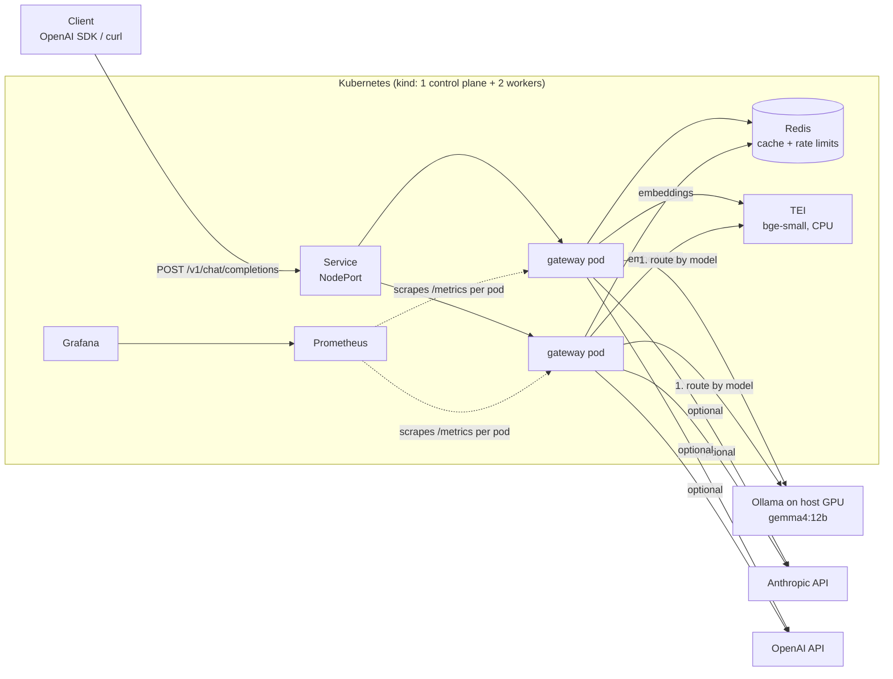
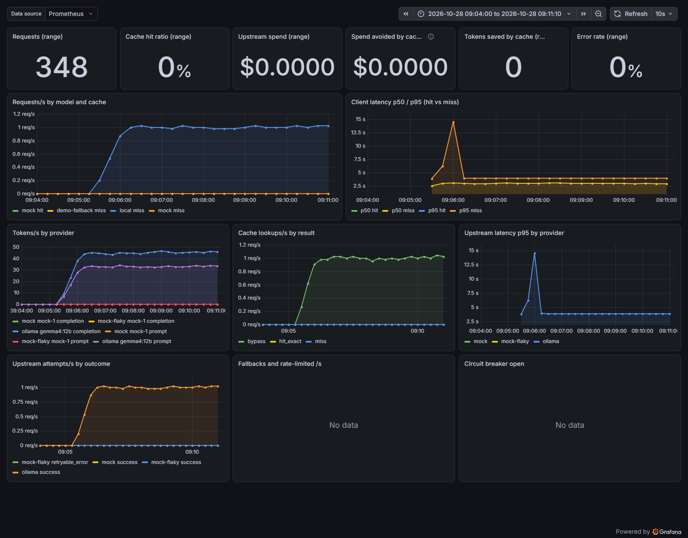
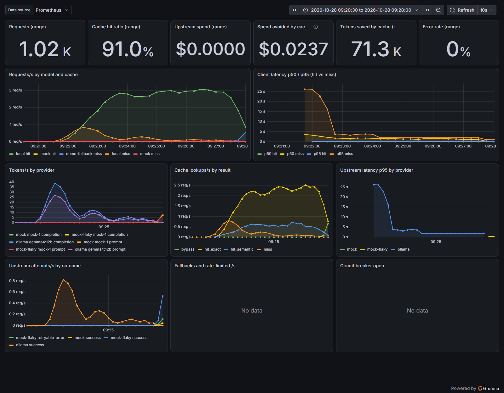
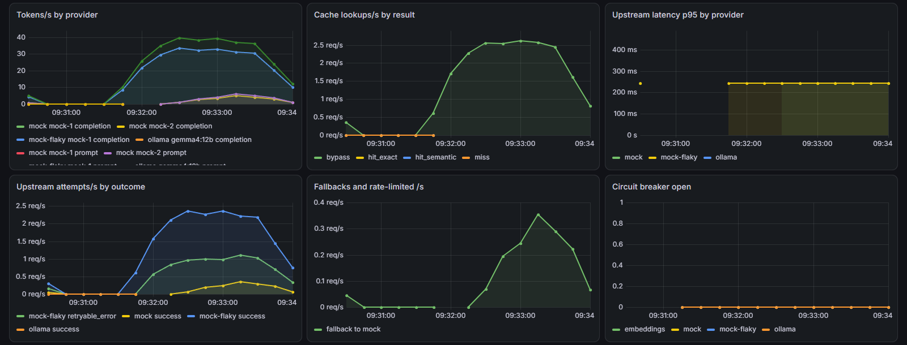

# llm-gateway

An OpenAI-compatible gateway that sits in front of several LLM providers and adds what applications need in production: **model routing, retries and cross-provider fallback, exact and semantic response caching, per-key rate limits, and per-request token, cost and latency metrics**. It ships with a Helm chart, a local Kubernetes setup (kind), a Grafana dashboard, a CI pipeline that deploys to a throwaway cluster, and a load test whose numbers are reproduced below.

Any OpenAI client works by changing its base URL:

```python
from openai import OpenAI

client = OpenAI(base_url="http://localhost:8090/v1", api_key="sk-team-a")  # kind; 8080 with Compose
client.chat.completions.create(model="local", messages=[{"role": "user", "content": "What is a Pod?"}])
```

## Architecture



Request path inside the gateway:

1. **Auth** – `Authorization: Bearer <key>` mapped to a key name (`GATEWAY_API_KEYS="team-a:sk-...,team-b:sk-..."`). No keys configured = local dev mode.
2. **Rate limit** – requests per minute and tokens per day per key, counted in Redis so the limits hold across replicas. Returns `429` with `Retry-After`.
3. **Cache lookup** – exact (SHA-256 of model, messages and sampling parameters), then semantic: the prompt is embedded and compared by cosine similarity with earlier prompts that share the same model, parameters and system prompt.
4. **Routing** – the `model` field is an alias (`local`, `fast`, `smart`, ...) that maps to an ordered list of `provider/model` targets in [`config/gateway.yaml`](config/gateway.yaml). `provider/model` (e.g. `ollama/gemma4:12b`) addresses a target directly.
5. **Retries and fallback** – each target gets `max_attempts` with exponential backoff for retryable errors (timeouts, 5xx, connection errors). 401/403/404/429 skip straight to the next target; other 4xx are returned to the client without fallback, since they would fail everywhere. A **circuit breaker** stops calling a provider after N consecutive failures and lets a trial call through after a cooldown. Streaming falls back only before the first token.
6. **Accounting** – Prometheus metrics, a JSON log line per request (`request_id`, key, provider, cache result, attempts, tokens, cost, latency) and response headers: `x-gateway-cache`, `x-gateway-provider`, `x-gateway-attempts`, `x-gateway-cost-usd`, `x-gateway-latency-ms`.

Providers are enabled by environment variable: `ANTHROPIC_API_KEY` and `OPENAI_API_KEY` turn on the hosted providers; without them their targets are skipped and routes fall back to Ollama. A `mock` provider (with an optional injected failure rate) needs no model at all and is what the tests and CI use.

### Design decisions worth knowing

- **Fail open on Redis.** If Redis is down, requests still reach the provider (no cache, no limits) and a warning is logged. The readiness probe therefore does not depend on Redis: a Redis outage should degrade the service, not pull every replica out of the load balancer at once.
- **Separate CPU embedder.** The first version asked Ollama for embeddings. On a single GPU with one loaded model, every embedding call evicted the chat model and the next completion paid a 13 s reload. The semantic cache now uses [Text Embeddings Inference](https://github.com/huggingface/text-embeddings-inference) with `BAAI/bge-small-en-v1.5` on CPU (~7 ms per query).
- **Semantic threshold chosen from measurements, not defaults.** With bge-small, "What is a Kubernetes Pod?" vs. "What is a Kubernetes Service?" scores **0.937**, while true paraphrases of the Pod question score 0.967–0.984. A 0.92 threshold would have served the Pod answer to the Service question, so the default is **0.96**. The load test reports semantic false hits explicitly.
- **Never cache empty answers.** `gemma4` reasons before answering; with a small `max_tokens` the whole budget went to hidden reasoning and the gateway returned (and cached) an empty string. The Ollama provider sends `reasoning_effort: none` by default and empty completions are never cached.
- **Cost of local models.** Ollama costs nothing per token, so "cost avoided" by the cache is valued at a configurable reference price (`gemma4:12b → claude-haiku-5-5`, $0.10 / $0.50 per 1M tokens). Real spend (`gateway_cost_usd_total`) stays at zero for local calls.
- **One worker per pod.** Scale with replicas, not processes: each pod exposes its own counters, Prometheus scrapes every pod and Grafana sums them.

## Run it locally

Requirements: Docker Desktop, and Ollama with `gemma4:12b` for the `local` route (the `mock` routes need nothing).

### Docker Compose (gateway + Redis + embedder + Prometheus + Grafana)

```bash
docker compose up -d --build
curl localhost:8080/v1/chat/completions -H 'content-type: application/json' \
  -d '{"model":"local","messages":[{"role":"user","content":"What is a Helm chart?"}]}'
scripts/smoke-test.sh http://localhost:8080
```

Grafana: http://localhost:3000 (dashboard **LLM Gateway**), Prometheus: http://localhost:9090.

### Kubernetes with kind

```bash
scripts/kind-up.sh        # cluster, kube-prometheus-stack, metrics-server, image, Helm release
scripts/smoke-test.sh http://localhost:8090
helm test llm-gateway -n llm
```

`kind-up.sh` creates a 3-node cluster from [`deploy/kind/kind-config.yaml`](deploy/kind/kind-config.yaml), installs kube-prometheus-stack (Prometheus Operator + Grafana), loads the locally built image into the nodes and installs the chart with [`values-kind.yaml`](deploy/helm/llm-gateway/values-kind.yaml). Gateway on http://localhost:8090, Grafana on http://localhost:3001, Prometheus on http://localhost:9091. Pods reach Ollama on the host through `host.docker.internal`.

What the chart deploys ([`deploy/helm/llm-gateway`](deploy/helm/llm-gateway)):

| Object | Purpose |
|---|---|
| Deployment (2 replicas) | Rolling updates with `maxUnavailable: 0`, startup/liveness/readiness probes, soft anti-affinity across nodes, non-root read-only container, config checksum annotation that restarts pods when config or secrets change |
| Service | ClusterIP by default, NodePort in kind |
| ConfigMap + Secret | Non-secret settings as env vars; provider and client keys in a Secret (or `secrets.existingSecret`); optional full `gateway.yaml` override mounted as a file |
| HorizontalPodAutoscaler | 2–6 replicas on CPU (needs metrics-server) |
| PodDisruptionBudget | Keeps one gateway pod during voluntary disruptions |
| Redis, TEI | Optional in-cluster dependencies; `redis.url` points to an external Redis instead |
| ServiceMonitor, dashboard ConfigMap | Scraping and the Grafana dashboard, picked up by kube-prometheus-stack |
| Helm test | Pod that checks `/readyz` and sends a real completion |

### Development

```bash
python -m venv .venv && .venv/Scripts/pip install -r requirements-dev.txt   # bin/ on Linux/macOS
ruff check . && ruff format --check . && pytest -q
GATEWAY_CONFIG=config/gateway.yaml uvicorn app.main:app --port 8080
```

Without a Redis on `localhost:6379` the gateway still answers (cache and limits fail open, `/readyz` reports `"redis": false`). Compose and kind publish their ports on `127.0.0.1` only.

## CI/CD

[`.github/workflows/ci.yml`](.github/workflows/ci.yml):

1. **lint-test** – ruff and pytest (fake Redis, mocked providers and HTTP transports).
2. **helm-lint** – `helm lint` and `helm template` for default and kind values.
3. **build-and-e2e** – builds the image, creates a kind cluster with the same config, loads the image, `helm upgrade --install --wait` with [`values-ci.yaml`](deploy/helm/llm-gateway/values-ci.yaml) (mock providers, exact cache), runs `helm test` and [`scripts/smoke-test.sh`](scripts/smoke-test.sh) through the NodePort (cache miss → hit, flaky → healthy fallback, metrics present), dumps pod state on failure, and on `main` pushes the image to GHCR tagged with the commit SHA.

## Load test results

Measured on 2026-10-28 against the **kind deployment** (2 gateway replicas behind a NodePort, Redis and TEI in the cluster) with `gemma4:12b` on Ollama on the host GPU (AMD RX 6800, Ollama serving one request at a time). Load: [locust](loadtest/locustfile.py), 4 concurrent users, 0.5–2 s think time, 6 minutes per run, `max_tokens: 64`. Prompts come from a pool of 40 DevOps/LLM questions with Zipf popularity, so a few questions are asked often and most rarely, and 30 % of requests use a hand-written paraphrase. Both runs use the same seed; the cache starts empty. Reproduce with [`scripts/run-benchmark.sh`](scripts/run-benchmark.sh) and [`loadtest/report.py`](loadtest/report.py). Raw output: [`loadtest/results/summary.json`](loadtest/results/summary.json).

| | Baseline (cache bypassed) | Semantic cache |
|---|---:|---:|
| Requests completed in 6 min | 358 | 958 |
| Throughput | 1.00 req/s | 2.78 req/s |
| Errors | 0 | 0 |
| Cache hit rate | – | **91.0 %** (702 exact + 170 semantic) |
| Semantic hits answering the wrong question | – | 0 of 170 |
| Latency p50 / p95, all requests | 2,719 / 3,538 ms | **47 / 1,307 ms** |
| Latency p50 / p95, cache hits | – | 46 / 56 ms |
| Latency p50 / p95, cache misses | 2,719 / 3,538 ms | 1,454 / 3,465 ms |
| Tokens served from cache | – | 68,939 of 75,789 (91 %) |
| Cost at reference price ($0.10 / $0.50 per 1M) | $0.0093 | $0.0252, of which **$0.0229 avoided** |
| Same, per 1M requests of this mix | $25.85 | $26.28, of which **$23.89 avoided** |

How to read it:

- **The hit rate belongs to this workload, not to the gateway.** Single-turn questions with Zipf repetition are close to a docs/support bot. Multi-turn chats with unique context would hit far less, mostly on exact retries. The useful results are that the cache costs ~50 ms on a hit, and that 170 paraphrase hits all returned the answer generated for the same question. The report checks this by matching every semantic hit against the question that produced the cached answer.
- **Misses also got faster** (p50 2.7 s → 1.5 s), because Ollama serves one request at a time: with 91 % of traffic answered from Redis, the remaining requests wait less in the GPU queue. The cached run also completed 2.7× more requests in the same time.
- **Where hit latency goes.** Inside the gateway, a hit takes ~3 ms at p50 and ~14 ms at p95, the p95 being semantic lookups that call the embedder (`gateway_request_duration_seconds`). The other ~40 ms seen by the client is the Windows → Docker Desktop → kind NodePort → kube-proxy path and locust itself.
- **Cost is in reference dollars.** The local model costs nothing per token, so savings are valued at Claude Haiku 5.5 prices, the configured reference for `gemma4:12b`. With a pricier hosted model the dollar figures scale with its price, but the token savings stay the same.
- **One run was discarded.** A first cached run (09:11–09:17 local time in the overview) overlapped with another process using the same GPU, and its misses took 20–55 s. It was repeated once the GPU was idle and only the clean run is reported. [`loadtest/results/timeline.txt`](loadtest/results/timeline.txt) has the exact windows.

## Dashboard

Grafana dashboard provisioned by the chart (kube-prometheus-stack in kind). Panels: request rate by model and cache result, client latency p50/p95 for hits vs misses, tokens per provider, cache lookups by result, upstream latency per provider, upstream attempts by outcome, fallbacks and 429s, circuit breaker state, plus totals for the selected range.

**Baseline run** (cache bypassed): ~1 req/s, every request goes to Ollama, p50 ≈ 2.7 s.



**Semantic cache run**: hits climb to ~2.5 req/s within two minutes, and misses drop to a trickle. The spike at the start is the first four requests (15 s each) waiting for the model to load into VRAM after another process had swapped it out. They are included in the table; the panel shows ~25 s because `histogram_quantile` interpolates inside the 15–30 s bucket.



**Fallback demo** (`demo-fallback` route, mock provider failing 30 % of the time): retries on the flaky provider absorb most failures; the rest fall back to the healthy provider, and clients see 0 errors over 310 requests.



## Metrics reference

| Metric | Labels | Meaning |
|---|---|---|
| `gateway_requests_total` | model, provider, status, cache | Requests handled |
| `gateway_request_duration_seconds` | model, cache | Client-visible latency (histogram) |
| `gateway_upstream_duration_seconds` | provider, upstream_model | Latency of each upstream call |
| `gateway_upstream_attempts_total` | provider, outcome | success, retryable_error, fatal_error, skipped_breaker, skipped_disabled |
| `gateway_fallbacks_total` | model, provider | Requests served by a non-primary target |
| `gateway_tokens_total` | provider, upstream_model, kind | Prompt and completion tokens sent upstream |
| `gateway_cost_usd_total` | provider, upstream_model | Upstream spend |
| `gateway_cache_lookups_total` | result | hit_exact, hit_semantic, miss, bypass, error |
| `gateway_cache_saved_tokens_total` / `gateway_cache_saved_usd_total` | kind / model | Tokens and spend avoided by cache hits |
| `gateway_rate_limited_total` | key, reason | 429s by key and limit |
| `gateway_circuit_open` | provider | 1 while a provider's breaker is open |

## Limitations and next steps

- Anthropic responses are not streamed token by token (the full answer is sent as one chunk); OpenAI-compatible providers stream natively.
- Only text content is supported; tool calls and images are not translated between provider formats. Request fields the gateway does not know (`tools`, `response_format`, `n`, ...) are dropped, not rejected.
- Auth is off when `GATEWAY_API_KEYS` is empty (the gateway logs a warning if a paid provider is enabled). With auth on, any key can still address `provider/model` directly, so it can use any model of an enabled provider, not only the aliases.
- The cache is shared by all API keys: a semantic hit can return an answer generated for another key's similar prompt. Multi-tenant deployments should scope it per key.
- Semantic search is a brute-force scan over the most recent 1,000 vectors per scope in Redis; beyond that, a vector index (Redis Stack, pgvector) would be needed.
- Not included: Ingress/TLS, NetworkPolicies, Redis high availability, autoscaling on custom metrics (in-flight requests) instead of CPU, and OpenTelemetry traces.
- Prices in `config/gateway.yaml` are examples; check each provider's pricing page before relying on cost figures.
